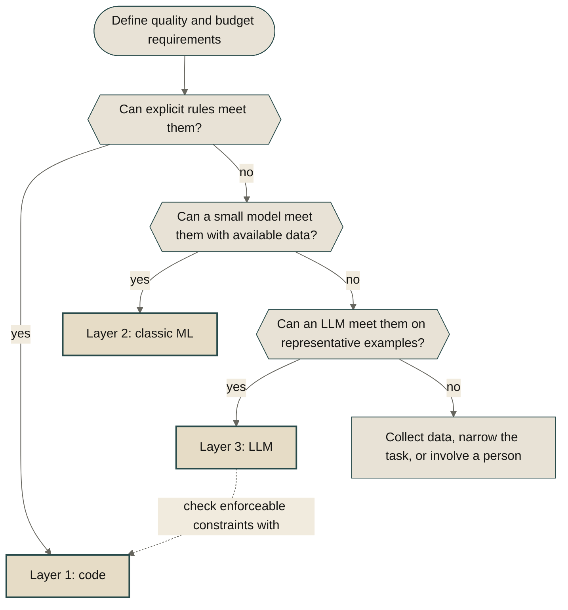

Think of application logic in three layers: explicit rules, classic ML, and LLMs. This is an engineering heuristic, not a strict taxonomy: learned models also run as code, and an LLM is itself a machine learning model.

For comparable application tasks, explicit rules and small predictive models are often cheaper and faster than an LLM. That is not a universal ordering. A deterministic simulation can be expensive, and a small local model can be fast. Measure the workload, including development and maintenance costs.

What an LLM often buys is flexibility. Sometimes the task needs it. Often it does not. Start with the simplest approach that meets the task's quality requirements, then compare cost and latency. A workflow can combine these approaches without needing all three.

That is easy to forget in 2026, when the default answer to every new task is "send it to an LLM". Parse a date? LLM. Forecast next week's sales? LLM. Check whether a discount breaks the margin? Also LLM. It works often enough that nobody asks what it costs.

# 🤔 Problem

LLMs make varied, unstructured inputs easier to handle through one interface, so it is tempting to use that interface for everything.

Take a function that checks whether a discounted price still clears the margin floor. With prices and costs already available, that is a small calculation and comparison. Explicit code makes the rule inspectable and inexpensive to run. A prompt adds model inference and another way to misinterpret the rule. The task did not get harder. Only the tool changed.

The reverse mistake exists too. Somebody writes 400 lines of `if` and `elif` to sort customer emails into categories, and every week a new phrasing slips through. That code is cheap, fast, and predictable, and it is still the wrong tool, because the input is plain language and nobody can list plain language in advance.

Both mistakes have the same cause. The tool got picked before anyone asked what the task needs.

# 🧱 The three layers

For each layer, ask what it costs, how fast it runs, whether results repeat, and what evidence supports their correctness. Then ask what flexibility you get in return.

## Layer 1: deterministic code

C, Rust, Java, JavaScript, Python. A person writes the rules and the machine follows them.

- **Cost:** often low for simple rules, but computation, development, and maintenance still cost money.
- **Speed:** depends on the algorithm and workload. A comparison is cheap; a simulation or database query may not be.
- **Repeatability:** deterministic logic gives the same output for the same inputs and fixed dependencies.
- **Correctness:** a function can be consistently wrong. Tests, review, and explicit invariants provide evidence; repeatability alone does not.

In return you get explicit control and enforceable rules. Those rules can generalize beyond examples the author considered, but they still need to match the problem.

## Layer 2: classic ML

Linear regression, gradient boosting, a logistic classifier. The rules come from data instead of from a person.

- **Cost:** small models can be inexpensive per prediction. Include data collection, training, monitoring, and retraining.
- **Speed:** small regressions and classifiers are often fast, but model size, preprocessing, and serving overhead matter.
- **Repeatability:** many deployed models are deterministic with fixed inputs, model versions, and inference settings.
- **Correctness:** a representative holdout set estimates performance on comparable data. It does not guarantee an error bound on future inputs, especially when the data distribution changes.

In return you get relationships learned from examples rather than specified by hand. A regression can estimate how weekday, season, price, and stock level relate to demand. Whether those relationships remain useful is something to test.

## Layer 3: LLMs

A pretrained language model steered by a prompt, sometimes also fine-tuned for a particular task.

- **Cost:** hosted services often charge per token. Self-hosting replaces that with hardware and operating costs. Compare the actual model, input length, output length, and workload.
- **Speed:** depends on model size, hardware, context length, generated tokens, and serving load. Measure end-to-end latency rather than assuming a fixed range.
- **Repeatability:** sampling can produce different outputs from the same prompt. Greedy decoding removes sampling randomness, but temperature 0 alone is not a guarantee of identical results across serving environments or model updates.
- **Correctness:** task-specific evals can estimate error rates, just as evaluation does for other models. Re-evaluate when the model, prompt, tools, or input distribution changes.

In return you get a flexible interface for free text, unfamiliar phrasing, and, with a suitable multimodal model, document images. You can often start without task-specific training data. You still need representative evaluation examples and clear acceptance criteria.

## Side by side

Repeatability and correctness answer different questions. **Repeatability:** does the same input produce the same output under fixed conditions? **Correctness:** what evidence shows that the output meets the task's requirements? A system can be repeatable and wrong, or produce varied answers that are all acceptable.

| | 1. Code | 2. Classic ML | 3. LLM |
| --- | --- | --- | --- |
| Rules come from | explicit logic | training data | pre&shy;training, prompts, sometimes fine-tuning |
| Cost drivers | development, maintenance, computation | data lifecycle, training, inference | integration, evaluation, tokens or hosting |
| Latency drivers | algorithm, I/O, workload | preprocessing, model size, serving | context, model size, output length, serving |
| Repeat&shy;ability | deterministic with fixed inputs and dependencies | often deterministic with a fixed model and settings | depends on decoding and serving conditions |
| Correctness evidence | tests, review, invariants | representative held-out evaluation | representative task-specific evaluation |
| What you buy | explicit control | learned relationships | flexible language interaction |

None of these provides a universal error guarantee. Choose the simplest layer that passes the task's quality checks, then measure its cost and latency.

# 🛠️ Solution

Start from the requirements, not from the tool.

Before choosing a layer, answer four questions about the task:

- What counts as correct, and what is the cost of a wrong answer?
- How much can one call cost?
- How long can it take?
- How much can an acceptable answer vary between runs?

A price check on every page view might need millisecond latency and strict enforcement of the margin rule. A product description written once per product might tolerate seconds of latency and different wording, but not invented product features. Zero variation is not enough: a consistently wrong answer still fails.

Walk the ladder from the bottom. Test explicit rules first; for a prediction task with representative historical data, evaluate a small model next. Consider an LLM when its capabilities fit the task, not simply because the other options failed. Each choice must meet the quality and budget requirements on representative examples.



The ladder picks an approach per task. A real system may need one layer, two, or all three. Missing training data is not evidence that an LLM can solve the problem.

- **Cheap layers first.** Let rules and small models handle cases they can resolve reliably, then route the rest onward. Measure routing rates and the full cost of fallback paths: even rare expensive calls can dominate average cost, and latency can worsen for requests that traverse every stage.
- **Deterministic checks on LLM output.** A schema checks structure. A rule can check that a cited file exists. Neither establishes that the content is true or that the citation supports the claim. State exactly what each check guarantees.
- **Compile down.** When the LLM repeatedly solves the same kind of problem, consider generating a function or training a small model from reviewed examples. Validate the replacement independently, then measure whether it actually reduces cost and latency.

## Mix the layers your agent needs

Agent workflows make the separation concrete.

In an LLM-driven agent loop, the model can interpret a request and choose a tool, the tool runs, and its result returns to the model. Control flow and tool execution need not involve language generation. A fixed workflow may not need an LLM to choose the next step at all.

- **Layer 1 runs the loop and the exact tools.** Control flow, retries, step limits, permissions, the database query, the calculator. If there is a rule, it is a function the agent calls, not a sentence in the prompt.
- **Layer 2 is the tool for estimates.** Which ticket is urgent, which document is relevant, what demand looks like next week. The agent gets a prediction whose measured performance applies to the evaluation conditions, not a guarantee about this individual answer.
- **Layer 3 does what is left.** It reads the messy request, decides what to call next, and writes the answer for a person.

Coding agents are a useful example. An LLM can turn an open-ended request such as "add retry to the upload client" into a proposed diff. Formatters, type checkers, and tests then check particular properties of that diff. Passing them is evidence, not proof that the change is correct or safe to merge. Review still has to cover the requirements and risks those checks miss. Stochastic author, deterministic checks.

An LLM should not do arithmetic it can call, or invent a forecast it can retrieve from an evaluated model. Those tools make the calculation or estimate inspectable, but wrong inputs and model errors can still produce wrong answers. Measure whether tool use reduces total cost and latency, including the extra calls and orchestration.

The lower layers gain as well. Nobody writes an `if` for "work out why sales dropped in Norway". With an LLM on top, the functions and models you already have can answer questions like that.

The best results do not come from the biggest model on every step. They come from every step running on the right layer.

## When multiple models might help

A review or plan may have no complete automated correctness check. Several models can propose alternatives or critique one another, but agreement is not a substitute for evidence.

Different models can share training data, assumptions, and systematic errors. A quorum can reinforce the same mistake, even when its members come from different providers. Repeating one model can explore alternative samples; neither repetition nor model diversity guarantees better accuracy.

Treat a quorum as an experiment. Compare it with a single-model baseline on representative cases using reference answers or qualified human review. Measure correctness, cost, and end-to-end latency, not just agreement. Define when to abstain or escalate, and retain deterministic checks wherever they apply. For high-consequence decisions, model agreement alone should not authorize action.

[Singularity by Swarm of Stochastic Intelligence](/blog/2026-02-02-singularity-by-swarm-of-stochastic-intelligence/) explores the broader idea. Whether an ensemble helps a particular workflow is an empirical question.

# 🧪 Example

Here are three possible combinations. Each uses all three layers to illustrate their roles, not because every system needs all three.

**Pricing.** An online shop reprices its catalog every night. The margin floor and the rounding to .99 are code: they must be exact, and they run for every product. The demand forecast is a regression: the answer is a number, there are years of sales history, and being a few percent off is acceptable in a nightly batch. The product description is an LLM job: it is written once per product, nobody notices a second of latency, and two different good sentences are not a bug.

**Data extraction.** Invoices arrive as PDFs and each one needs a total. After text extraction, a parser for common layouts proposes the invoice fields. A small classifier can route other known layouts to a matching parser. An LLM handles remaining candidates. Recognition is only routing: a regex match or confident layout prediction is not proof that the total is correct.

This illustrative Python pseudocode leaves the parsers and source-aware validator application-specific. Each parser returns a candidate invoice or `None` for an unsupported or unparseable document. Candidates include line amounts, tax, shipping, discounts, currency, and the stated total.

```python
def candidates(text: str):
    yield parse_common_layout(text), 1

    layout, confidence = classify_layout(text)
    if layout in PARSERS and confidence >= LAYOUT_THRESHOLD:
        yield PARSERS[layout](text), 2

    yield ask_llm_for_invoice(text), 3


def extract_total(text: str) -> Extraction:
    for invoice, layer in candidates(text):
        if invoice is None:
            continue
        if validates_against_source(invoice, text):
            return Extraction(total=invoice.total, layer=layer)

    raise NeedsReview("No candidate passed invoice validation")
```

The generator tries later stages only if an earlier candidate is missing or fails the shared check. `validates_against_source` must check required fields and their evidence in the source, currency consistency, and reconciliation using decimal amounts and the invoice's rounding policy. The calculation must account for line amounts, tax, shipping, and discounts without double-counting amounts already included in the lines. Missing or ambiguous evidence fails validation rather than becoming an assumed zero. Unsupported invoice conventions go to review.

Reconciliation checks arithmetic consistency, not whether a charge is legitimate. Even a balanced extraction can contain a repeated or misread amount, so source checks and representative evaluation still matter.

Choose `LAYOUT_THRESHOLD` using held-out data and measured false-routing costs; a confidence score of 0.9 does not automatically mean 90% accuracy. Record the stages attempted, the accepted layer, actual cost, and elapsed time. Layer labels provide provenance, not a trust score. Measure how often fallback occurs and what it costs before claiming that the pipeline is cheap or fast.

**An agent.** The same shop adds an agent, and the owner asks: "what should I put on sale this week?" The LLM reads the question and plans the calls. A query returns stock and cost per product (layer 1). The demand model estimates sales at 10, 20, and 30 percent off (layer 2). The margin function checks every candidate against the floor, and checks the final list again before any price changes (layer 1). The LLM picks a shortlist and explains it in plain language (layer 3). Nothing here is new: the margin function and the demand model are the ones from the nightly run. The agent only decides when to call them.

The textbook cases split the same way. A tax calculation is code. A spam filter is a classifier. A summary of a long email thread is an LLM.

# 🚀 Take it further

- **Log the route.** Record which stages each request attempted, which layer answered, what the full request cost, and how long it took. Include failed checks and fallback calls.
- **Set quality and variance budgets.** Decide both what counts as correct and whether different acceptable answers are allowed. Marketing copy can vary but must not invent claims. Prices and permissions need enforceable rules, not merely repeatable outputs.
- **Justify every step up.** Before a task moves up a layer, write down what the lower layer could not do. If the list is empty, stay down.
- **Give your agents lower-layer tools.** Each time an agent adds, sorts, counts, or forecasts in its own head, write the tool and take that work away from it.
- **Evaluate a quorum before relying on it.** Compare multiple-model workflows with a single-model baseline using independently assessed correctness, cost, and latency. Keep an escalation path for cases that cannot be verified.

An LLM is one layer of the stack, not a replacement for it. Use the simplest approach that meets the task's quality requirements, climb only when the task asks for it, and combine only the layers you need. Repeatability is not correctness, and agreement is not proof.

# 📚 References

- [Singularity by Swarm of Stochastic Intelligence](/blog/2026-02-02-singularity-by-swarm-of-stochastic-intelligence/)
- [Local Models Are Not Worse Cloud Models](/blog/2026-06-18-local-models-are-not-worse-cloud-models/)
- [You Should Write An Agent](/blog/2025-11-07-you-should-write-an-agent/)
- [Chain Prompts Like Unix Tools with Dotprompt](/blog/2025-11-27-dotprompt-unix-pipes/)
