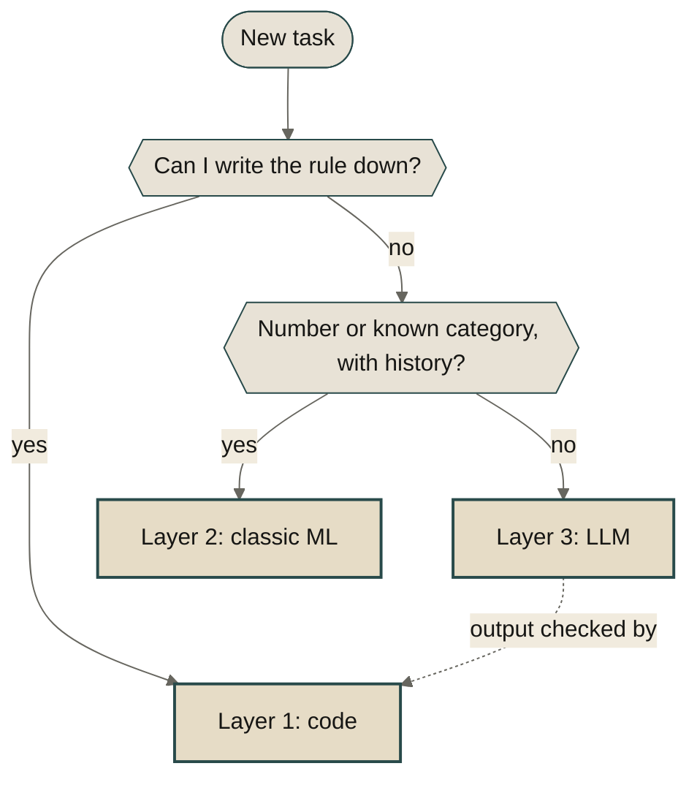

There are three layers of compute: deterministic code, classic ML, and LLMs. They differ on three things you can measure: cost, speed, and predictability.

Each step up costs more, runs slower, and is harder to predict.

What you buy with that is flexibility. Sometimes the task needs it. Often it does not, and then the lowest layer that solves the problem is the right one. The best agent workflows mix all three.

That is easy to forget in 2026, when the default answer to every new task is "send it to an LLM". Parse a date? LLM. Forecast next week's sales? LLM. Check whether a discount breaks the margin? Also LLM. It works often enough that nobody asks what it costs.

# 🤔 Problem

The LLM is the only layer that accepts any input, so it becomes the layer for every input.

Take a function that checks whether a discounted price still clears the margin floor. As code it is one comparison. It runs in nanoseconds, costs nothing, and returns the same answer every time. As a prompt it takes a second or two, shows up on the invoice, and can return a different answer on Tuesday than it did on Monday. The task did not get harder. Only the tool changed.

The reverse mistake exists too. Somebody writes 400 lines of `if` and `elif` to sort customer emails into categories, and every week a new phrasing slips through. That code is cheap, fast, and predictable, and it is still the wrong tool, because the input is plain language and nobody can list plain language in advance.

Both mistakes have the same cause. The tool got picked before anyone asked what the task needs.

# 🧱 The three layers

Same three questions for each layer, in the same order: what does a call cost, how fast is it, how predictable is the answer. Then what you get in return.

## Layer 1: deterministic code

C, Rust, Java, JavaScript, Python. A person writes the rules and the machine follows them.

- **Cost:** near zero per call. You pay once, in developer time.
- **Speed:** nanoseconds to microseconds.
- **Predictability:** same input, same output, exact. A bug is wrong the same way on every run, so you can find it, and a unit test keeps it fixed.

In return you get nothing you did not ask for. The code handles the cases somebody thought of, and no others.

## Layer 2: classic ML

Linear regression, gradient boosting, a logistic classifier. The rules come from data instead of from a person.

- **Cost:** a little CPU per call, plus the one-time cost of collecting data and training.
- **Speed:** microseconds to milliseconds.
- **Predictability:** same input, same output, but the output is an estimate. The model is wrong some of the time, and a holdout set tells you how often.

In return you get rules nobody could write by hand. No one can type out how weekday, season, price, and stock level combine into next week's demand. A regression finds it in the sales history.

## Layer 3: LLMs

A pretrained model steered by a prompt. Nobody wrote the rules, and nobody trained it for your task.

- **Cost:** billed per token, on every call. Run the model yourself and the bill turns into GPU time. Either way it is orders of magnitude more compute per call than the layers below.
- **Speed:** hundreds of milliseconds to many seconds.
- **Predictability:** the output is sampled, so the same prompt can give a different answer on the next run. Temperature 0 narrows that. It does not remove it. There is also no error rate to look up. You measure it yourself with evals, and a new model version means measuring again.

In return you get input nobody planned for: free text, a document layout you have never seen, a question phrased in a new way. No rules to write, no training data to collect.

## Side by side

Predictability is two properties. Repeatable: the same input gives the same output. Bounded: you know how wrong the output can be. Code has both. Classic ML is repeatable and has a measured bound. An LLM has neither until you build them around it.

| | 1. Code | 2. Classic ML | 3. LLM |
| --- | --- | --- | --- |
| Rules come from | a person | data | pre&shy;training and a prompt |
| Cost per call | near zero | low, plus training | per token |
| Speed | nano&shy;seconds to micro&shy;seconds | micro&shy;seconds to milli&shy;seconds | hundreds of milli&shy;seconds to seconds |
| Predict&shy;ability | repeat&shy;able, exact | repeat&shy;able, known error rate | varies per run, error unknown |
| What you buy | nothing extra | patterns nobody can write down | input nobody planned for |

Going up, you spend cost, speed, and predictability to buy flexibility. Going down, you get them back.

# 🛠️ Solution

Start from the budget, not from the tool.

Before choosing a layer, answer three questions about the task:

- How much can one call cost?
- How long can it take?
- How much can the answer vary between runs?

A price check that runs for every product on every page view has a budget of roughly nothing, a few milliseconds, and zero variation. A product description written once per product has a budget of cents, seconds, and plenty of variation. Those two tasks do not belong on the same layer.

Then walk the ladder from the bottom:

1. Can I write the rule down? Use code.
2. Is the answer a number or a known category, and do I have history? Use classic ML.
3. Is the input open-ended language, or a shape I cannot list? Use an LLM.



The ladder picks a layer per task. A real system has many tasks, so it ends up with all three layers. The combinations that work share one idea: use the top layer where you need flexibility, and buy the three axes back everywhere else.

- **Cheap layers first.** Let code and a small model answer what they can, and send only the leftovers to the LLM. Average cost and latency stay close to layer 1.
- **Deterministic checks on LLM output.** A schema, a test suite, a rule that every cited file must exist. This buys predictability back.
- **Compile down.** When the LLM keeps solving the same kind of problem, have it write the function once and run the function from then on, or use its answers to train a small model. This buys cost and speed back.

## Mix all three in your agent workflows

Agent workflows are where the mix pays off most.

An agent is a loop. The LLM picks a tool, the tool runs, the result goes back to the LLM. Only the picking needs layer 3. The loop and the tools can live on the layers below.

- **Layer 1 runs the loop and the exact tools.** Control flow, retries, step limits, permissions, the database query, the calculator. If there is a rule, it is a function the agent calls, not a sentence in the prompt.
- **Layer 2 is the tool for estimates.** Which ticket is urgent, which document is relevant, what demand looks like next week. The agent calls the model and gets a number with a known error rate.
- **Layer 3 does what is left.** It reads the messy request, decides what to call next, and writes the answer for a person.

Coding agents are the clearest case. The LLM writes the change, because no other layer can turn "add retry to the upload client" into a diff. Then the formatter, the type checker, and the test suite decide whether the diff lands. Stochastic author, deterministic judge.

An LLM should not do arithmetic it can call, or guess a forecast it can look up. Every number in the answer then comes from a layer that can be trusted with it. And wherever a tool replaces work the LLM would do token by token, the agent gets cheaper and faster too.

The lower layers gain as well. Nobody writes an `if` for "work out why sales dropped in Norway". With an LLM on top, the functions and models you already have can answer questions like that.

The best results do not come from the biggest model on every step. They come from every step running on the right layer.

## Solve the stochastic part with a quorum

A deterministic judge needs something to check. Some LLM output has no test: a review, a diagnosis, a plan. Nobody can write an assert that says the plan is right. And a single run can fail, or come back confidently wrong.

So do not ask once, and do not ask one model.

1. Give the same task to several models.
2. Hand the results to a quorum of judges, also different models.
3. Keep what the quorum agrees on. Send the rest back, or to a person.

It works like asking experts in a field. Each one has a different solution, and what they generally agree on tends to be true. One bad sample is noise. Agreement between models with different training and different blind spots is signal. A single LLM that fails or produces a bad outcome no longer decides the result. The quorum does.

The models have to differ. Five runs of one model smooth out bad luck, but they share one set of blind spots and can agree on the same mistake.

The price is on the same three axes: several calls where one would do, and more waiting unless they run in parallel. You spend cost and speed to buy predictability back. So use a quorum where a wrong answer is expensive and no lower layer can judge. Agreement is not proof, and a deterministic check still wins wherever one exists.

This is the argument from [Singularity by Swarm of Stochastic Intelligence](/blog/2026-02-02-singularity-by-swarm-of-stochastic-intelligence/): no single expert is reliable, and people solved that long ago with consensus.

# 🧪 Example

Three systems. Each one uses all three layers.

**Pricing.** An online shop reprices its catalog every night. The margin floor and the rounding to .99 are code: they must be exact, and they run for every product. The demand forecast is a regression: the answer is a number, there are years of sales history, and being a few percent off is acceptable in a nightly batch. The product description is an LLM job: it is written once per product, nobody notices a second of latency, and two different good sentences are not a bug.

**Data extraction.** Invoices arrive as PDF and each one needs a total. A regex catches the layouts seen most often. A small classifier recognizes the other known layouts and hands the text to the matching parser. Only an invoice that neither one recognizes goes to the LLM.

```python
def extract_total(text: str) -> Extraction:
    if match := TOTAL_PATTERN.search(text):
        return Extraction(total=Decimal(match["total"]), layer=1)

    layout, confidence = classify_layout(text)
    if confidence >= 0.9:
        return Extraction(total=PARSERS[layout](text), layer=2)

    return Extraction(total=ask_llm_for_total(text), layer=3)
```

Whichever layer answered, the result goes through the same check: the total has to equal the sum of the line items. Most invoices never reach the last line of the function, so average cost and latency stay near layer 1. And because every result records its layer, you know what each answer cost and how far to trust it.

**An agent.** The same shop adds an agent, and the owner asks: "what should I put on sale this week?" The LLM reads the question and plans the calls. A query returns stock and cost per product (layer 1). The demand model estimates sales at 10, 20, and 30 percent off (layer 2). The margin function checks every candidate against the floor, and checks the final list again before any price changes (layer 1). The LLM picks a shortlist and explains it in plain language (layer 3). Nothing here is new: the margin function and the demand model are the ones from the nightly run. The agent only decides when to call them.

The textbook cases split the same way. A tax calculation is code. A spam filter is a classifier. A summary of a long email thread is an LLM.

# 🚀 Take it further

- **Log the layer.** Record which layer answered each request, what it cost, and how long it took. Few teams have seen that breakdown for their own product.
- **Set a variance budget.** Decide per feature whether a different answer on the next run is acceptable. Marketing copy: yes. Prices, permissions, anything that moves money: no.
- **Justify every step up.** Before a task moves up a layer, write down what the lower layer could not do. If the list is empty, stay down.
- **Give your agents lower-layer tools.** Each time an agent adds, sorts, counts, or forecasts in its own head, write the tool and take that work away from it.
- **Use a quorum where it counts.** For LLM calls with no test and a high cost of being wrong, run several models and let other models judge.

An LLM is the top layer of the stack. It is not a replacement for the stack. Use the lowest layer that solves the problem, climb only when the task asks for it, and build agents that use all three. Where only an LLM can judge, ask more than one.

# 📚 References

- [Singularity by Swarm of Stochastic Intelligence](/blog/2026-02-02-singularity-by-swarm-of-stochastic-intelligence/)
- [Local Models Are Not Worse Cloud Models](/blog/2026-06-18-local-models-are-not-worse-cloud-models/)
- [You Should Write An Agent](/blog/2025-11-07-you-should-write-an-agent/)
- [Chain Prompts Like Unix Tools with Dotprompt](/blog/2025-11-27-dotprompt-unix-pipes/)
